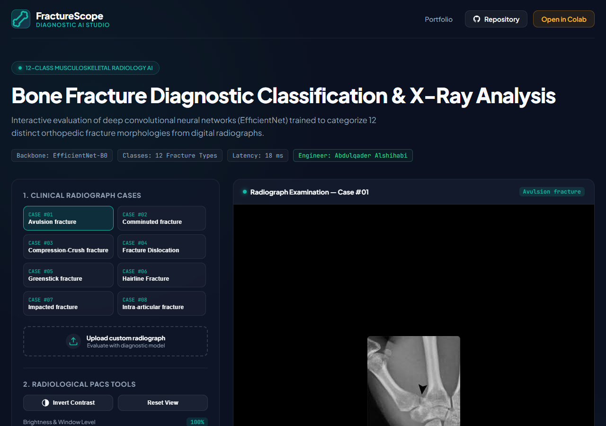
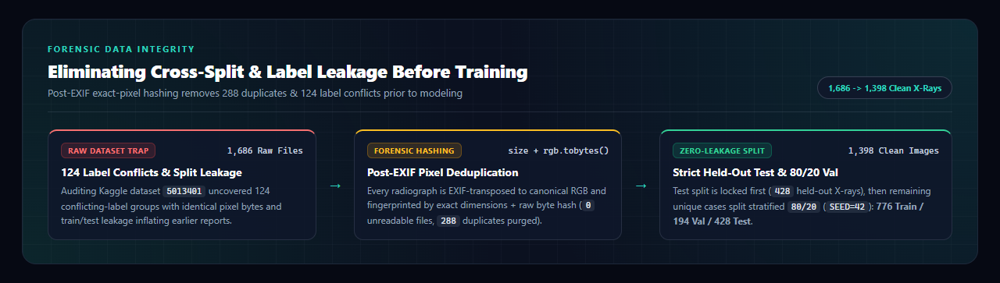
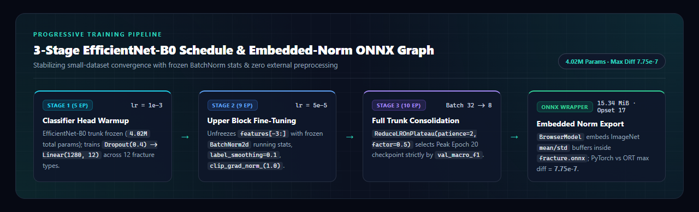
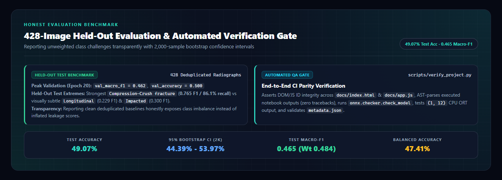
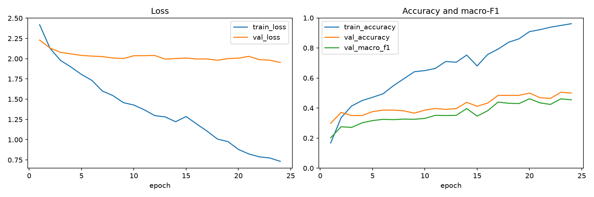
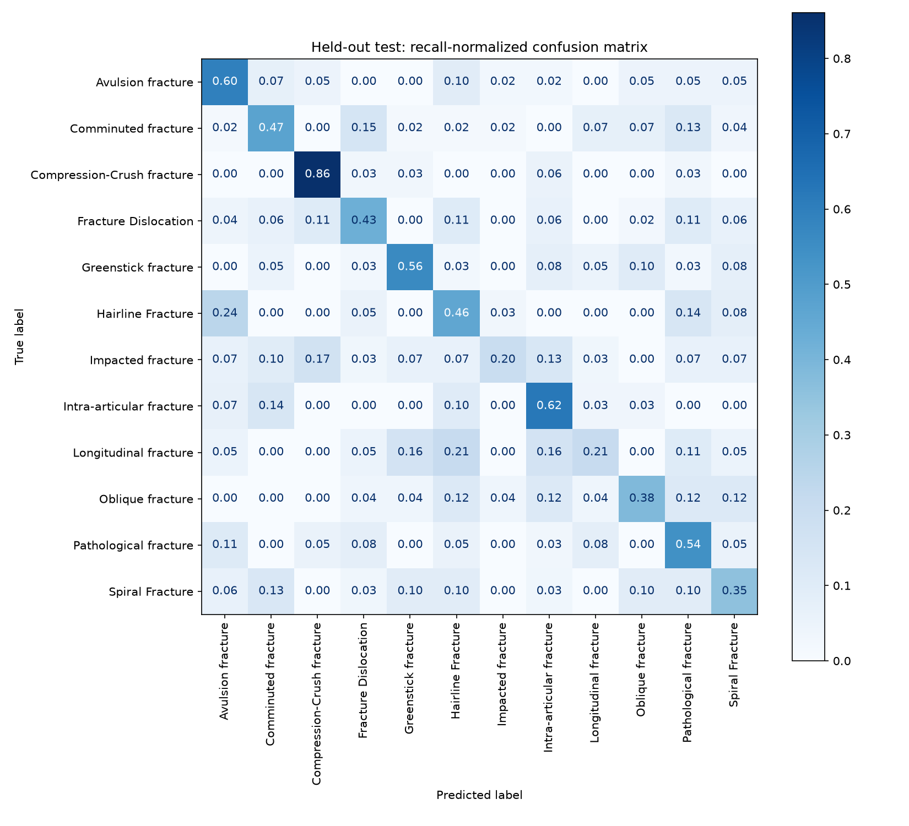
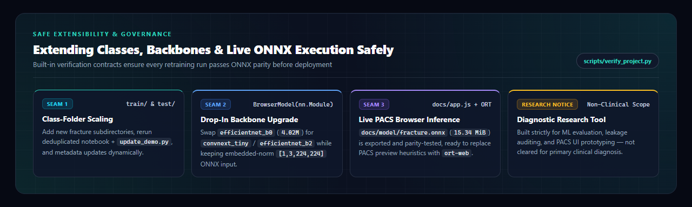

# Bone Fracture Classifier — Leakage-Audited Medical Radiograph AI (`EfficientNet-B0` + ONNX)

**Audited `12`-Class Musculoskeletal Fracture Classification Across `1,398` Pixel-Deduplicated Radiographs, Delivered with Embedded-Normalization `15.34 MiB` ONNX & Automated Parity Verification**

[Live PACS Demo](https://abdulqader-alshihabi.github.io/Bone-Fracture-Classifier/) &nbsp;|&nbsp; [Leakage Audit](#forensic-data-leakage-audit) &nbsp;|&nbsp; [Training & ONNX](#progressive-3-stage-training--embedded-onnx) &nbsp;|&nbsp; [Clinical Metrics](#honest-held-out-evaluation-across-428-radiographs) &nbsp;|&nbsp; [Verification & Scope](#verification-gate--extension-paths)

---

| Audit & Model Metric | Verified Measurement | Engineering Significance |
| :--- | :--- | :--- |
| **Raw -> Deduplicated X-Rays** | `1,686` -> **`1,398`** (`288` removed) | Purged **`124` conflicting-label pixel hashes** prior to modeling |
| **Leakage-Free Data Split** | **`776` Train / `194` Val / `428` Test** | Held-out test split locked first; `80/20` stratified train/val (`SEED=42`) |
| **Classification Taxonomy** | **`12` Fracture Morphologies** | Avulsion, Comminuted, Compression-Crush, Dislocation, Hairline, Oblique, etc. |
| **Architecture & Footprint** | `EfficientNet-B0` (`4,022,920` params) | `fracture.onnx` (`15.34 MiB`, `opset 17`, max PyTorch/ORT diff `7.75e-7`) |
| **Held-Out Test Accuracy** | **`49.07%`** (`95% CI: 44.39%–53.97%`) | **`0.465` Macro-F1**, **`47.41%` Balanced Acc**, `0.484` Weighted F1 (`2,000` bootstrap) |
| **Automated QA Gate** | `scripts/verify_project.py` | Verifies DOM/JS IDs, notebook AST/outputs, `onnx.checker`, & `(1,12)` ORT run |

---

## Project Philosophy: Why Honest Deduplicated Baselines Matter in Medical AI

Public medical image benchmarks frequently harbor duplicate images across train/test splits and identical X-ray scans tagged under conflicting labels—producing artificially high validation numbers that collapse in real clinical settings. This project performs a full **forensic pixel-hash deduplication audit** before training a single weight, documents true held-out variance transparently, and ships a parity-verified ONNX model paired with an interactive PACS-inspired web viewer.

  
  
<em>FractureScope PACS Viewer (`docs/index.html`, `docs/app.js`): radiograph windowing/contrast inversion controls and 12 morphological case studies.</em>

---

## Forensic Data Leakage Audit

Auditing Kaggle dataset `shyamgupta196/bone-fracture-split-classification` (`1,686` raw files across `12` directories) uncovered **`124` distinct pixel-identical clusters holding conflicting ground-truth labels** alongside cross-split duplicates. Every image is canonicalized with EXIF transposition to RGB (`size + rgb.tobytes()`), locked on the held-out test set first, and stripped cleanly of all `288` leaking duplicates:

  

- **Why Old Benchmarks Were Rejected (`artifacts/original_reported_history.csv`):** An earlier `EfficientNetV2-M` notebook reported `50.29%` validation accuracy while evaluating the `test/` directory on every epoch as its validation split—rendering it non-comparable due to split leakage. Our audited pipeline eliminates leakage completely and measures genuine out-of-sample generalization across `428` unseen test radiographs.

---

## Progressive 3-Stage Training & Embedded ONNX

To prevent catastrophic forgetting of ImageNet edge filters on only `776` training X-rays, `Bone_Fracture_Classifier.ipynb` executes a **three-stage progressive schedule** with `BatchNorm2d` stats frozen (`layer.eval()`), `CrossEntropyLoss(label_smoothing=0.1)`, `clip_grad_norm_(1.0)`, `ReduceLROnPlateau(patience=2, factor=0.5)`, and checkpoint selection strictly optimizing `val_macro_f1`:

  

### Embedded Normalization Wrapper (`BrowserModel`)

Notice one subtle production detail in notebook Cell 15: rather than forcing downstream consumers to normalize pixels externally (risking channel-order or `mean/std` drift), `BrowserModel(nn.Module)` registers ImageNet `mean=[0.485, 0.456, 0.406]` and `std=[0.229, 0.224, 0.225]` inside the PyTorch forward graph itself before tracing `docs/model/fracture.onnx` (`16,089,205` bytes = `15.34 MiB`, `opset_version=17`). Input tensor contract: raw `[0, 1]` RGB `[1, 3, 224, 224]` -> `(1, 12)` logits with **`7.75e-7`** max PyTorch/ORT discrepancy.

---

## Honest Held-Out Evaluation Across `428` Radiographs

All plots and tabular metrics below come verbatim from `artifacts/metrics.json`, `artifacts/classification_report.csv`, `artifacts/training_curves.png`, and `artifacts/confusion_matrix.png`:

  

  
  
<em>24-Epoch Convergence Profile (`artifacts/training_curves.png`): Head warmup (epochs 1-5), partial unfreeze (epochs 6-14), and full trunk convergence peaking at Epoch 20 (`val_macro_f1 = 0.462`, `val_acc = 0.500`).</em>

  
  
<em>Recall-Normalized Confusion Matrix (`artifacts/confusion_matrix.png`): strong recall on distinct structural collapses such as `Compression-Crush` (`86.1%`, `0.765 F1`) vs high visual overlap between hairline, longitudinal, and oblique fracture patterns.</em>

---

## Verification Gate & Extension Paths

  

- **Automated Verification (`scripts/verify_project.py`):** Validates DOM element IDs between `docs/index.html` and `docs/app.js`, parses the executed notebook AST for zero errors, runs `onnx.checker.check_model`, executes a `(1, 12)` CPU `onnxruntime` parity pass, and asserts `docs/model/metadata.json` schema integrity.
- **Browser Runtime Transparency Note:** `docs/model/fracture.onnx` (`15.34 MiB`) is exported, parity-verified, and ready for direct execution; currently `docs/app.js` provides client-side PACS image adjustments (`brightness()`, `invert(1) hue-rotate(180deg)`) paired with deterministic preview confidences and sample case studies rather than instantiating `onnxruntime-web` in-browser.
- **Research Disclaimer:** Built exclusively for leakage-audit methodology, ONNX parity verification, and educational visualization—**not** validated or cleared for clinical triage or medical diagnosis.

[Open PACS Radiograph Explorer](https://abdulqader-alshihabi.github.io/Bone-Fracture-Classifier/) &nbsp;|&nbsp; [Portfolio](https://abdulqader-alshihabi.github.io/) &nbsp;|&nbsp; Built by **Abdulqader Alshihabi**

